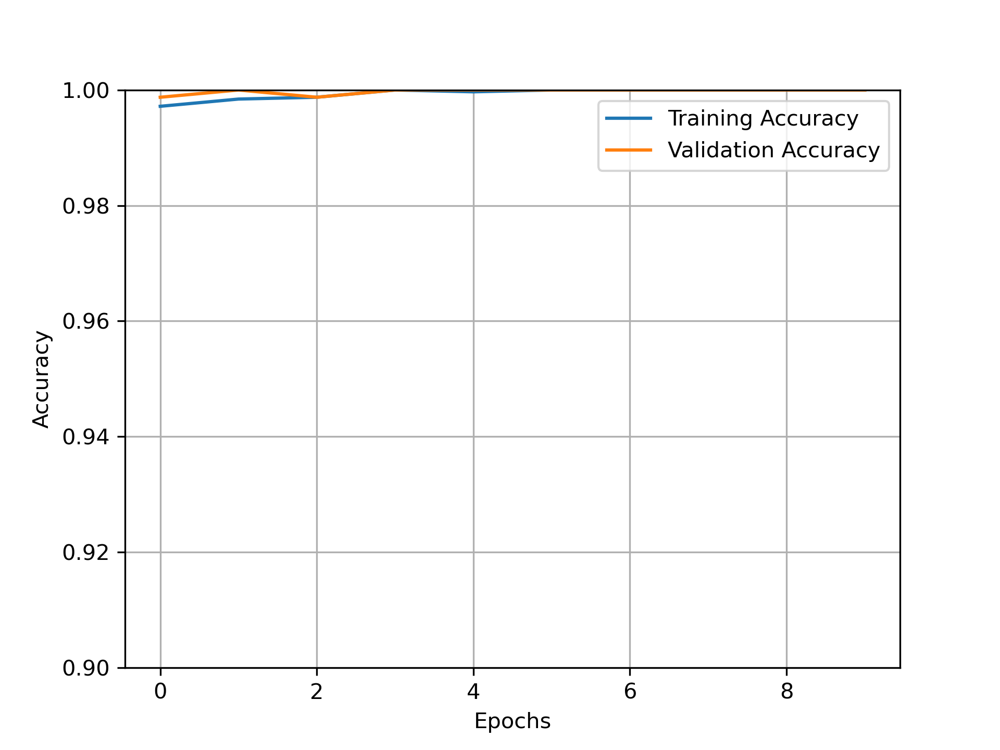
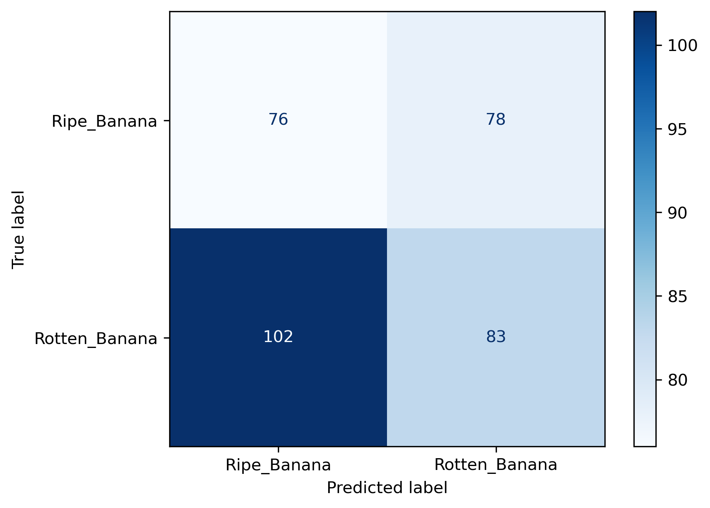

# Food Bank Rotten Fruit Identifier

Image classifiers that tell fresh fruit from fruit that is starting to rot, so a grocery store
could pull produce for a food bank before it becomes waste. Six-person group project for
CMPE 257 (Machine Learning) at San Jose State University, Fall 2024. Each member built a
model for one fruit, and all six models are in
[`groupFinal_FruitClassification.ipynb`](groupFinal_FruitClassification.ipynb).

| Fruit | Built by |
|---|---|
| Banana | Peter Conant |
| Tomato | Megan Gross |
| Apple | Lindsey Raven |
| Orange | Sonal Prasad |
| Mango | Ashley Irawan |
| Bell pepper | Pushpal Patil |

The rest of this README covers the banana model, which is my part.

## The banana model

**Headline result: 99.9% accuracy on validation, 47% on a different dataset.** The model learned
the training dataset rather than what a rotting banana looks like. Finding that out was the
most useful thing this project taught me.

### Approach

Transfer learning from ResNet50 with ImageNet weights. The ResNet50 base is frozen and used as
a feature extractor. A small trainable head sits on top:

```
ResNet50 (frozen, 2048-d pooled features)
  -> Flatten
  -> Dense(512, ReLU)
  -> Dense(2, softmax)        ripe | rotten
```

- Input: 224 × 224 RGB images
- Training: Adam (learning rate 0.001), categorical cross-entropy, 5 epochs
- Data: 3,985 labelled banana images from the Kaggle dataset
  [Fruits fresh and rotten for classification](https://www.kaggle.com/datasets/sriramr/fruits-fresh-and-rotten-for-classification),
  split 80/20 into 3,188 for training and 797 for validation

I also tried three variants: a 224-unit hidden layer, no hidden layer (softmax directly on the
ResNet features), and a sigmoid output. All three performed about the same as the original.

### Results

On the validation split, the model scored 99.9–100% accuracy from the first epoch, finishing
at 796 of 797 images correct:



That number was too good to trust. So I tested the model on 339 banana images from a
**separate** Kaggle dataset,
[Banana Classification](https://www.kaggle.com/datasets/atrithakar/banana-classification),
which it had never seen:



| | Validation (same source as training) | Separate dataset |
|---|---|---|
| Images | 797 | 339 |
| Accuracy | 99.9% (796 of 797) | **46.9%** (159 of 339) |

On the separate dataset it caught 83 of 185 rotten bananas (44.9%) and correctly passed 76
of 154 ripe ones (49.4%). On new data the model is no better than a coin flip. It is worse than always answering
"rotten", which would score 54.6%.

### Why it failed

Near-perfect validation accuracy that falls to chance on a new dataset is the classic sign of
**shortcut learning**: the model separated the classes using something that only marks the
label within one dataset (background, lighting, camera, framing) instead of the fruit itself.
The validation split came from the same source as the training images, so it shared those
shortcuts and could not reveal the problem. Only the outside dataset could.

### What I would do next

- **Use the outside dataset as the main metric**, not the validation split.
- **Train on several sources mixed together**, so no single dataset's quirks predict the label.
- **Augment** with colour, lighting, crop and background changes to break those shortcuts.
- **Crop to the fruit first** (the group's original plan included a detection model) so the
  background cannot be used.
- **Check what the model looks at** with Grad-CAM before trusting any accuracy number.
- **Fine-tune the top ResNet50 blocks**, not just the head, once the data problem is fixed.

## Repository layout

```
groupFinal_FruitClassification.ipynb   all six models; the banana model is the "Banana Model" section
figures/                               banana model training curves, architecture, test confusion matrix
wrong_format_finder.py                 finds image files TensorFlow cannot load before training
```

The notebook was run in Colab and locally, so its dataset paths point at the original
machines. Change them to your own copy of the data before running it.
